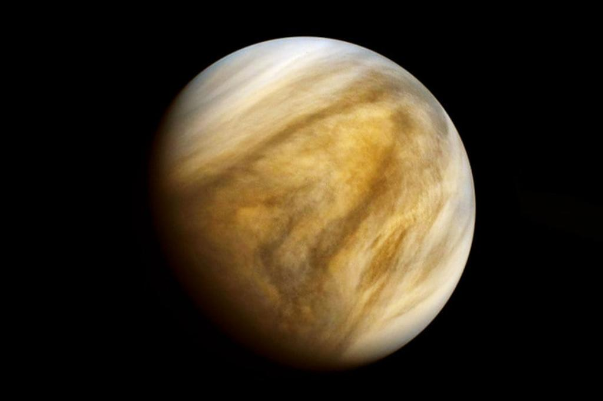

# Daily fact 2026-11-25

Tags: Science

**A day on Venus is longer than a year on Venus.**

- One complete rotation on its axis: approximately **243 Earth days**.
- One orbit around the Sun: approximately **225 Earth days**.
- Venus also rotates in the opposite direction to most planets in our solar system.

In other words, Venus completes an orbit around the Sun before completing one rotation on its axis.
