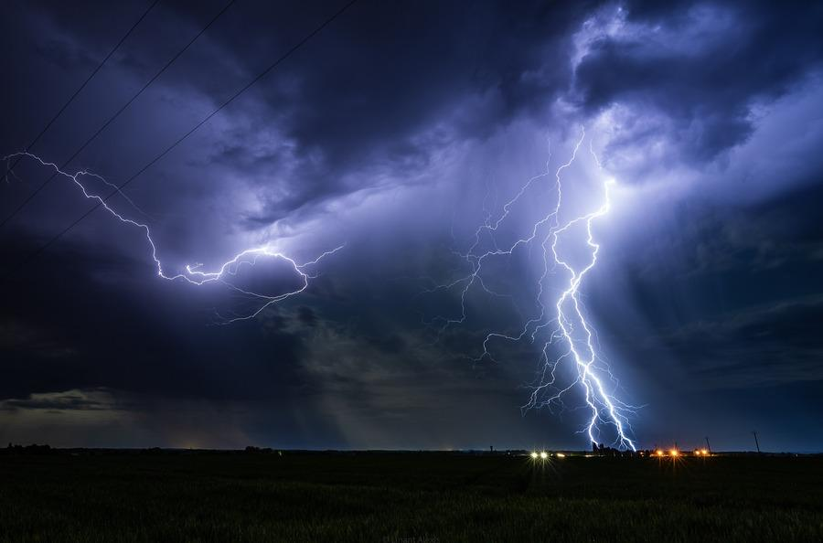

# Daily fact 2026-11-26

Science

**Lightning is approximately five times hotter than the surface of the Sun.**

- Lightning channels can reach approximately **30,000°C**.
- The Sun's visible surface (photosphere) is approximately **5,500°C**.
- This extreme heating causes the surrounding air to expand explosively, producing the sound we hear as thunder.

A lightning strike lasts only a fraction of a second, but it releases enough energy to heat the surrounding air to extraordinary temperatures.
