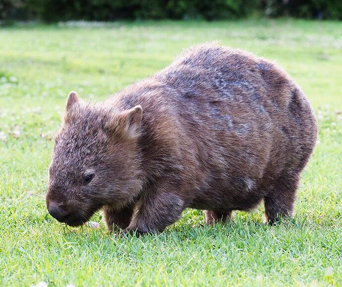
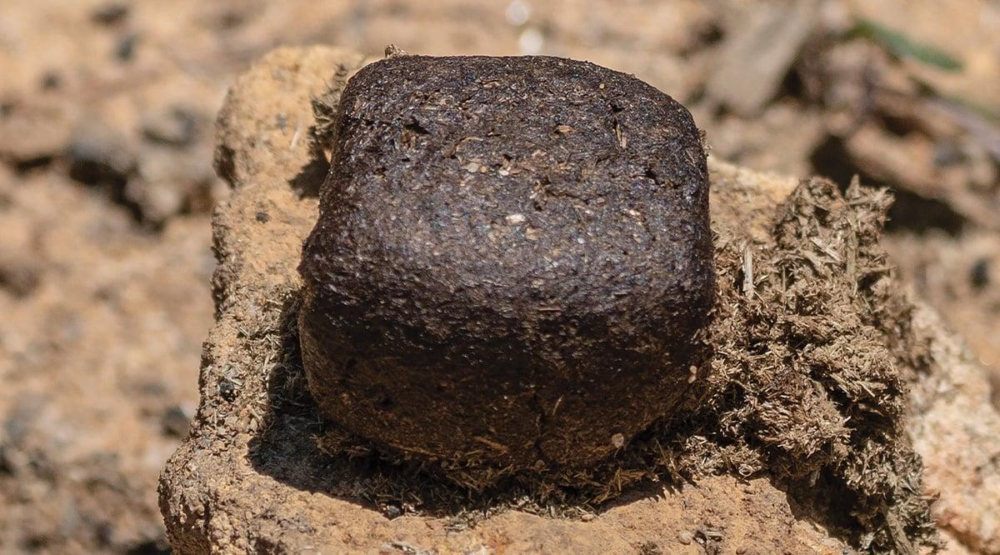
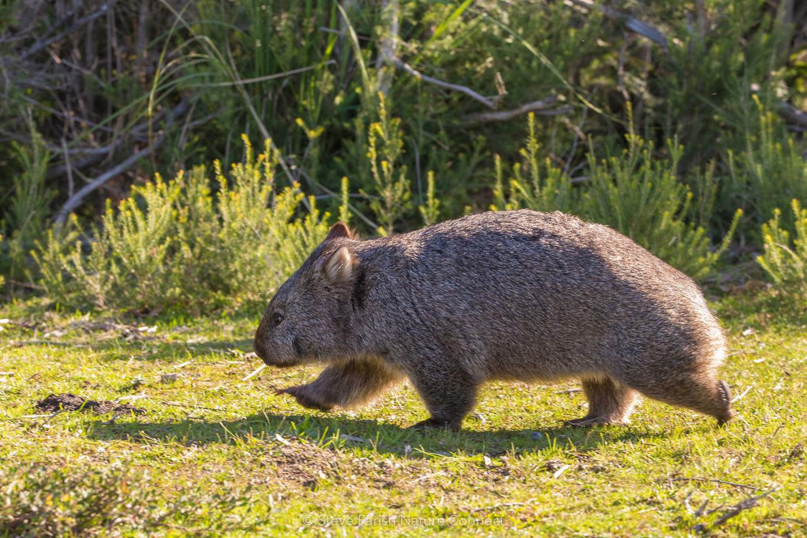

# Daily fact 2026-11-27

Science · Animal Physiology

**Wombats produce cube-shaped feces. They are the only known animals to do this.**

The explanation is surprisingly technical:

- The distinctive shape forms inside the intestine, not at the anus.
- The final section of the intestine has alternating stiff and flexible regions.
- Muscular contractions and the drying of fecal material help create the flat sides and sharp corners.
- Researchers published this mechanism in the journal *Soft Matter* in 2021.

Scientists also suggest that cube-shaped droppings help wombats mark their territory without the droppings rolling away.

**Interesting implication:** A biological digestive system has effectively evolved a natural mechanism for manufacturing geometric shapes.
