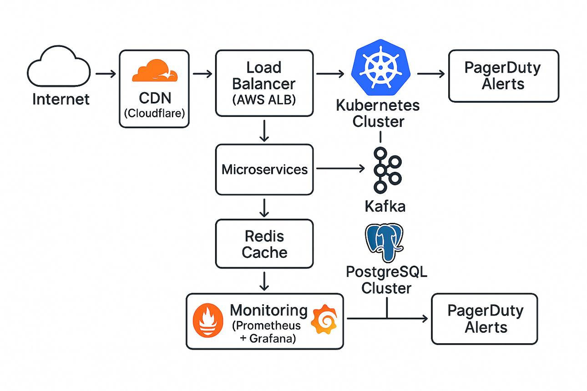
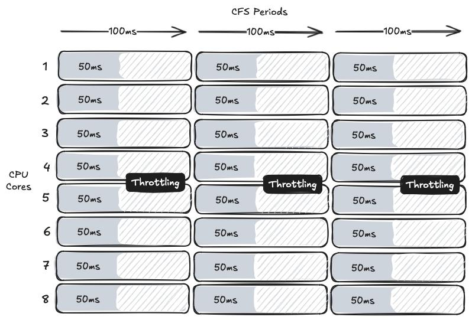
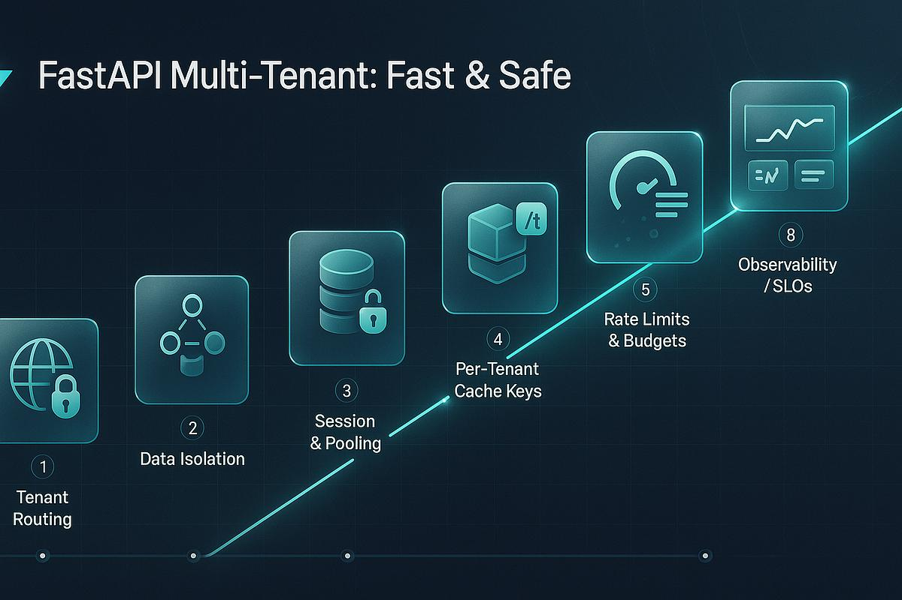
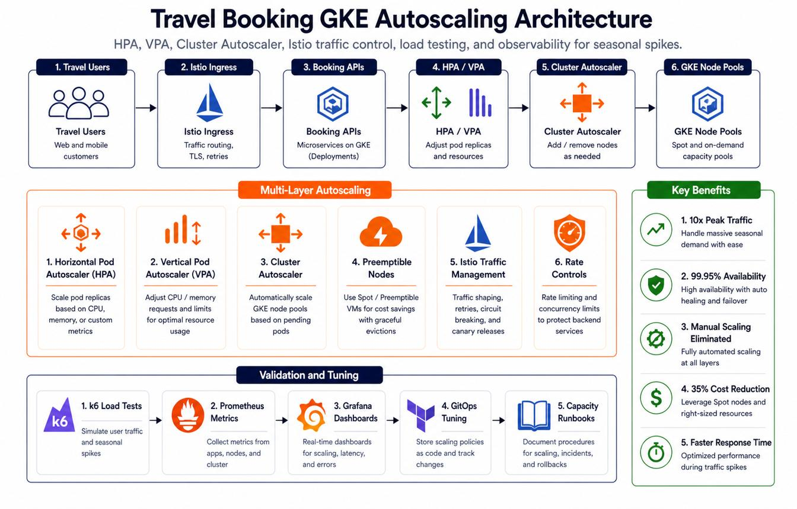

## **Daily IT Challenge #05 — Diagnosing a Kubernetes CPU and Latency Incident**

Tags: Performance engineering, Go runtime, Kubernetes, Incident response

November 28, 2026

### **Scenario**

You are the technical lead responsible for a high-throughput Go API running on Kubernetes.

The service handles search requests for a multi-tenant SaaS platform. It retrieves data from three downstream services, applies tenant-specific authorization rules, aggregates results, serializes JSON, and returns a compressed HTTP response.

The service has operated reliably for six months.

Over the last two weeks, p99 latency has increased dramatically. Adding replicas has produced inconsistent improvements. The infrastructure team reports that cluster-wide CPU utilization remains relatively low.

You are asked to lead the production investigation.

Your task is to identify the bottleneck, explain the interactions between application concurrency, Linux CPU scheduling, Kubernetes resource limits, and autoscaling, then propose a production-safe remediation.

### **1. System architecture**



[medium.com](https://medium.com/%40osomudeyazudonu/surviving-10k-concurrent-users-the-ultimate-devops-scaling-playbook-6e2d61c089d4?utm_source=chatgpt.com)

Infrastructure:

| Component         | Configuration                     |
| ----------------- | --------------------------------- |
| Kubernetes        | v1.33                             |
| Container runtime | containerd                        |
| Operating system  | Linux, cgroup v2                  |
| Go version        | 1.22.4                            |
| API replicas      | 40                                |
| Node capacity     | 32 vCPU per node                  |
| CPU request       | 500m per pod                      |
| CPU limit         | 1000m per pod                     |
| Memory request    | 1 GiB                             |
| Memory limit      | 2 GiB                             |
| HPA minimum       | 12 replicas                       |
| HPA maximum       | 80 replicas                       |
| HPA CPU target    | 70% of requested CPU              |
| Traffic           | 8,000 RPS normal, 12,000 RPS peak |

The application does not explicitly configure `GOMAXPROCS`.

The service uses HTTP/2 between the ingress and application pods. The ingress maintains long-lived connections and uses connection-level load distribution.

Twelve large tenants account for approximately 65% of total request volume.

### **2. Incident symptoms**

Production incident

The service's latency has deteriorated.

| Metric                 | Before incident | Current    |
| ---------------------- | --------------- | ---------- |
| p50 latency            | 90 ms           | 110 ms     |
| p95 latency            | 180 ms          | 900 ms     |
| p99 latency            | 350 ms          | 3,800 ms   |
| Error rate             | 0.05%           | 1.8%       |
| Throughput             | 8,000 RPS       | 12,000 RPS |
| API replicas           | 24              | 40         |
| Average CPU per pod    | 280m            | 290m       |
| Average memory per pod | 850 MiB         | 1.1 GiB    |

The HPA is not scaling aggressively because average CPU utilization remains close to its target.

However, individual pods behave very differently.

#### **Per-pod CPU distribution**

CPU usage across representative pods

CPU usage in millicores. The container limit is 1,000m.

0m250m500m750m1KmPod 01Pod 02Pod 03Pod 04Pod 05Pod 06Pod 07Pod 08Pod 09Pod 10Pod 11Pod 12

The remaining pods are also lightly loaded.

The eight hottest pods account for most of the latency degradation.

#### **CPU throttling**

| Metric                | Hot pods | Cold pods |
| --------------------- | -------- | --------- |
| CPU throttled periods | 31%      | 1%        |
| Average CPU           | 850–920m | 120–180m  |
| CPU limit             | 1,000m   | 1,000m    |
| Goroutines            | 18,000   | 2,500     |

Node-level CPU utilization is only 48%.

#### **Other observations**

- PostgreSQL p99 query latency remains below 12 ms.
- Downstream service p99 latency remains between 40–60 ms.
- Network packet loss is negligible.
- Memory usage remains below the container limit.
- Go GC CPU consumption increased from 6% to 14%.
- Go GC pause time p99 remains below 4 ms.
- Goroutine count increases during traffic spikes and remains elevated for several minutes after traffic decreases.

### **3. Application code**

The following simplified implementation is used by the search endpoint.

```

func (s *Service) Search(
    ctx context.Context,
    ids []string,
) ([]Result, error) {

    results := make(chan Result, len(ids))
    errs := make(chan error, len(ids))

    for _, id := range ids {
        go func(id string) {
            result, err := s.fetch(ctx, id)

            if err != nil {
                errs <- err
                return
            }

            results <- result
        }(id)
    }

    var output []Result

    for range ids {
        select {
        case result := <-results:
            output = append(output, result)

        case err := <-errs:
            return nil, err
        }
    }

    return output, nil
}

```

Additional details:

- Each request can contain up to 64 IDs.
- Each `fetch()` call performs an HTTP request to a downstream service.
- HTTP requests use a shared connection pool.
- The request handler has a 2-second context deadline.
- The downstream HTTP client has its own 5-second timeout.
- The application has no global concurrency limit for outbound requests.
- The endpoint performs JSON serialization and gzip compression before returning the response.

### **4. Go runtime and Linux configuration**

The container runs on a node with 32 logical CPUs.

The pod has:

```
resources:
  requests:
    cpu: "500m"
    memory: "1Gi"
  limits:
    cpu: "1"
    memory: "2Gi"
```

Runtime inspection reports:

```
runtime.NumCPU() = 32
runtime.GOMAXPROCS(0) = 32
```

The Go application does not import `go.uber.org/automaxprocs`.

The Linux container uses cgroup v2.

You can inspect:

```
cat /sys/fs/cgroup/cpu.max

cat /sys/fs/cgroup/cpu.stat

cat /sys/fs/cgroup/cpu.pressure

cat /sys/fs/cgroup/memory.current
```

Assume the standard Linux CFS CPU bandwidth controller is enabled.

### **5. Profiling evidence**

The team captures CPU profiles using `net/http/pprof`.

A representative profile shows:

| Function or category                   | CPU percentage |
| -------------------------------------- | -------------- |
| `compress/flate.(*compressor).deflate` | 28%            |
| `encoding/json`                        | 16%            |
| Authorization policy evaluation        | 13%            |
| Go scheduler                           | 9%             |
| Garbage collection                     | 14%            |
| HTTP transport and TLS                 | 8%             |
| Other                                  | 12%            |

The goroutine profile shows a substantial number of goroutines waiting in:

- HTTP transport connection acquisition.
- Channel receive operations.
- Downstream response processing.
- JSON serialization.

The block profile shows increasing contention around shared application-level synchronization.

No single downstream dependency explains the incident.

### **6. Your investigation challenges**

#### **A. Diagnose the CPU behavior**

Explain the relationship between:

- `runtime.NumCPU()`
- `GOMAXPROCS`
- Kubernetes CPU requests
- Kubernetes CPU limits
- Linux CPU quotas
- CFS throttling
- Go scheduler parallelism

Answer these questions:

1. Why can a container report 32 logical CPUs while being limited to one CPU?
2. What does `GOMAXPROCS=32` mean under a 1-core CPU quota?
3. How does CFS throttling affect request latency?
4. Why can CPU throttling increase p99 latency without causing high node-level CPU utilization?
5. Would increasing the CPU limit solve the underlying problem or merely move the bottleneck?

Distinguish CPU utilization from CPU entitlement and CPU throttling.

#### **B. Analyze the Go concurrency model**

Review the supplied `Search()` implementation.

Identify:

- Goroutine lifecycle problems.
- Cancellation behavior.
- Unbounded concurrency.
- Channel behavior.
- Error propagation problems.
- Potential goroutine leaks.
- Resource exhaustion risks.

Consider a workload of 12,000 requests/sec, with each request containing an average of 40 IDs.

Calculate the potential outbound request generation rate before considering caching or deduplication.

Then evaluate the effect of the 2-second request deadline when downstream calls remain blocked for up to 5 seconds.

#### **C. Explain the latency amplification**

The downstream services report stable latency.

The database reports stable latency.

The Kubernetes nodes report moderate CPU utilization.

Yet API p99 latency is 3.8 seconds.

Construct a causal explanation involving:

1. Request concurrency.
2. Goroutine scheduling.
3. CPU quota enforcement.
4. Compression and JSON serialization.
5. Connection pool contention.
6. Garbage collection.
7. Queueing and tail latency.

Explain why a relatively small increase in average CPU usage can cause a disproportionate increase in p99 latency.

Consider the relationship between utilization and queueing delay. Apply Little's Law where useful:

\\[ L = \lambda W \\]

#### **D. Investigate the autoscaling failure**

The HPA reports approximately 58% average CPU utilization against a 70% target.

However, some pods are nearly saturated.

Explain:

- Why average CPU utilization hides per-pod hotspots.
- How HTTP/2 connection reuse affects traffic distribution.
- Why adding replicas may not redistribute existing long-lived connections effectively.
- Whether CPU utilization is the right scaling signal.
- Whether scaling on request concurrency, queue depth, or in-flight requests would improve responsiveness.

Design an autoscaling strategy that avoids both under-scaling and excessive replica churn.

#### **E. Design the remediation**

Propose a prioritized remediation plan.

Your plan must cover:

**Go runtime**

- CPU-aware `GOMAXPROCS`.
- Goroutine scheduling.
- GC behavior.
- Profiling and runtime observability.

**Application**

- Bounded concurrency.
- Cancellation propagation.
- Per-request and global concurrency limits.
- HTTP connection pooling.
- Compression strategy.
- Backpressure.

**Kubernetes**

- CPU requests and limits.
- HPA configuration.
- Pod distribution.
- Ingress connection balancing.
- Graceful termination and connection draining.

Do not simply recommend removing CPU limits. Explain the operational and multi-tenant consequences of each change.

### **7. Failure and load-test scenarios**

Your design must survive the following tests.

| ##  | Scenario                                           | What to investigate                               |
| -- | -------------------------------------------------- | ------------------------------------------------- |
| 1  | Traffic increases from 8k to 20k RPS in 10 seconds | Autoscaling reaction and queue growth             |
| 2  | One tenant suddenly generates 40% of traffic       | Noisy-neighbor isolation                          |
| 3  | One downstream service becomes 10x slower          | Concurrency exhaustion and cancellation           |
| 4  | Downstream service returns HTTP 429                | Retry amplification and backpressure              |
| 5  | Kubernetes reduces available CPU capacity          | Throttling and graceful degradation               |
| 6  | Pod receives SIGTERM during peak traffic           | In-flight request handling                        |
| 7  | A request contains 64 IDs and 30% fail             | Partial failure and cancellation semantics        |
| 8  | Traffic drops by 80%                               | Goroutine recovery and resource reclamation       |
| 9  | Compression workload doubles                       | CPU saturation and latency impact                 |
| 10 | HPA scales from 40 to 80 replicas                  | Connection redistribution and downstream pressure |

For each scenario, define:

- Expected behavior.
- Relevant metrics.
- Failure threshold.
- Mitigation.
- Recovery behavior.

### **8. Observability and profiling**

Define a production monitoring strategy using Prometheus, Grafana, OpenTelemetry, and Go pprof.

At minimum, investigate these signals:

| Signal                                      | Purpose                    |
| ------------------------------------------- | -------------------------- |
| `container_cpu_usage_seconds_total`         | CPU consumption            |
| `container_cpu_cfs_throttled_periods_total` | Throttling frequency       |
| `container_cpu_cfs_throttled_seconds_total` | Throttling duration        |
| `container_cpu_pressure`                    | CPU contention             |
| Go goroutine count                          | Concurrency and leaks      |
| Go heap allocation rate                     | Allocation pressure        |
| GC CPU fraction                             | Runtime overhead           |
| HTTP in-flight requests                     | Application concurrency    |
| HTTP request duration histogram             | Tail latency               |
| Outbound connection wait time               | Connection pool contention |
| Per-tenant request rate                     | Workload imbalance         |

Explain which metrics need per-pod visibility and which can be aggregated safely.

Define alert thresholds for:

- CPU throttling.
- p99 latency.
- Goroutine count.
- In-flight request saturation.
- HPA maximum replica saturation.
- Downstream request failures.

### **9. Engineering trade-offs**

Evaluate these alternatives.

| Decision       | Option A               | Option B                        |
| -------------- | ---------------------- | ------------------------------- |
| CPU management | Fixed `GOMAXPROCS`     | Runtime-aware CPU configuration |
| CPU limits     | Strict CPU limits      | Higher or no CPU limits         |
| Concurrency    | Goroutine per ID       | Bounded worker pool             |
| Scaling        | Average CPU            | Multiple custom metrics         |
| Load balancing | Connection-level       | Request-aware balancing         |
| Compression    | Always gzip            | Adaptive compression            |
| Isolation      | Shared worker capacity | Per-tenant concurrency budgets  |

For each choice, discuss performance, cost, operational complexity, fairness, and failure behavior.

### **10. Evaluation criteria**

| Dimension                              | Weight |
| -------------------------------------- | ------ |
| Root cause identification              | 20%    |
| Go runtime and concurrency reasoning   | 20%    |
| Linux and Kubernetes CPU understanding | 20%    |
| Latency and queueing analysis          | 15%    |
| Remediation quality                    | 15%    |
| Observability and incident response    | 10%    |

A good solution must distinguish symptoms from causes.

Increasing replicas is not a root-cause analysis. Increasing CPU limits is not necessarily an architectural fix. Reducing GC frequency without understanding allocation behavior can make the problem worse.

### **Central engineering question**

**How do you design a Go service that remains latency-stable under bursty, highly skewed multi-tenant workloads when its container CPU entitlement is substantially smaller than the CPU topology visible to the runtime?**

The objective is not merely to make the service faster under average load.

It is to control resource consumption, preserve fairness, prevent queue amplification, and maintain predictable tail latency under overload.

---

## **Daily IT Challenge #05 — Complete Solution**

Solution

Go + Kubernetes + Distributed Systems

### **1. Executive diagnosis**

The incident is caused by several interacting bottlenecks, not one isolated infrastructure failure.

The primary problems are:

1. **CPU topology mismatch:** Go sees 32 CPUs, but Kubernetes grants each container only one CPU.
2. **CPU throttling:** Go schedules work across many logical processors, while Linux enforces a much smaller CPU quota.
3. **Unbounded concurrency:** Each incoming request can spawn up to 64 goroutines, creating excessive outbound requests.
4. **Traffic imbalance:** Long-lived HTTP/2 connections concentrate traffic on a subset of pods.
5. **CPU-intensive serialization:** JSON serialization and gzip compression consume substantial CPU.
6. **Ineffective autoscaling:** Average CPU utilization hides hot pods and does not accurately represent application queueing.

The result is a feedback loop:

**Traffic increases**

**More goroutines and outbound requests**

**CPU contention and CFS throttling**

**Increased processing and queueing latency**

**More concurrent in-flight requests**

Positive feedback loop

The most important insight: adding replicas does not necessarily solve a workload that is incorrectly distributed and internally unbounded.

### **2. CPU topology mismatch**

#### **2.1 Why does Go see 32 CPUs?**

The node has 32 logical CPUs.

Go's `runtime.NumCPU()` reports the logical CPU count available according to the runtime's CPU topology detection.

In this scenario:

```
runtime.NumCPU()      // 32
runtime.GOMAXPROCS(0) // 32
```

But the Kubernetes container has:

```
resources:
  limits:
    cpu: "1"
```

One CPU is equivalent to 1,000 millicores.

Under cgroup v2, the CPU quota is typically represented as:

```
/sys/fs/cgroup/cpu.max

100000 100000
```

The values are:

```
quota  = 100000 microseconds
period = 100000 microseconds
```

Therefore:

\\[ CPU\_{\text{available}} = \frac{100000}{100000}=1 \\]

The container can consume one CPU-second of CPU time per wall-clock second, averaged over the quota period.

It does not mean the container is assigned a dedicated physical CPU.

#### **2.2 What happens with GOMAXPROCS=32?**

`GOMAXPROCS` controls the maximum number of Go scheduler Ps that can execute Go code simultaneously.

With:

```
GOMAXPROCS = 32
CPU quota  = 1 CPU
```

Go can attempt to execute work using 32 Ps, but the kernel limits aggregate CPU consumption to one CPU equivalent.

Consider this simplified timeline:



[dev.to](https://dev.to/rdforte/the-implications-of-running-go-in-a-containerised-environment-3bp1?utm_source=chatgpt.com)

When multiple threads execute simultaneously:

- They consume the CPU quota faster.
- The cgroup exhausts its available runtime budget.
- Linux throttles the cgroup.
- Runnable threads wait until more CPU bandwidth becomes available.

This creates scheduling delays.

A request can spend considerable time waiting to execute even when its code is computationally ready.

#### **2.3 Why is node CPU utilization only 48%?**

Because CPU quota is enforced at the container level, not by requiring the entire node to be busy.

The node can have available CPU capacity while an individual container is throttled.

For example:

- Pod A is limited to 1 CPU and attempts to consume 4 CPUs.
- Pod A exhausts its quota.
- Pod A gets throttled.
- Other pods remain idle.
- Node utilization remains moderate.

This is why cluster-level CPU utilization is insufficient for diagnosing container CPU starvation.

#### **2.4 Recommended solution: CPU-aware GOMAXPROCS**

Use runtime-aware CPU configuration.

For Go 1.25 and later, the standard runtime automatically considers CPU affinity and cgroup CPU quota when determining the default `GOMAXPROCS`.

For the challenge's Go 1.22 runtime, use a compatible library such as `automaxprocs`.

```
import (
    "go.uber.org/automaxprocs/maxprocs"
)

func main() {
    _, err := maxprocs.Set()
    if err != nil {
        panic(err)
    }

    // Start application
}
```

For this container, the expected effective configuration is approximately:

```
NumCPU()   = 32
GOMAXPROCS = 1
```

This reduces excessive parallel execution and quota exhaustion.

It does not guarantee low latency. The application still has a one-CPU processing budget.

**Important distinction:** `GOMAXPROCS` is not a goroutine limit. It does not prevent the application from creating thousands of goroutines.

### **3. Analyze the Go concurrency bug**

The supplied implementation has several problems.

#### **3.1 Unbounded concurrency**

```
for _, id := range ids {
    go func(id string) {
        result, err := s.fetch(ctx, id)
        // ...
    }(id)
}
```

Each request creates up to 64 goroutines.

At 12,000 RPS:

\\[ 12,000 \times 40 = 480,000 \\]

480,000 outbound requests/sec

This is the theoretical outbound request generation rate if every ID produces one fetch.

The actual number of simultaneously active operations depends on latency, caching, connection pooling, and cancellation.

But the generation rate is already a serious concern.

#### **3.2 Goroutine explosion**

Suppose average downstream latency is 50 ms.

Using Little's Law:

\\[ L = \lambda W \\]

\\[ L = 480,000 \times 0.05 \\]

\\[ L = 24,000 \\]

Approximately 24,000 outbound operations are in flight under those assumptions.

If downstream latency increases to 500 ms:

\\[ L = 480,000 \times 0.5 = 240,000 \\]

This is a tenfold increase in concurrent operations.

This is how a modest downstream degradation can produce a substantial increase in memory consumption, goroutine scheduling overhead, and connection contention.

#### **3.3 Incorrect cancellation and error handling**

The original code has another important issue.

When one goroutine sends an error:

```
case err := <-errs:
    return nil, err
```

The function returns immediately.

However, other goroutines continue executing.

The parent function does not cancel their work.

The buffered channels avoid some blocked sends, but they do not solve the unnecessary background work.

The HTTP requests may continue until their own five-second timeout.

This is especially problematic because the parent request has only a two-second deadline.

#### **3.4 Incorrect result semantics**

The implementation also assumes every ID must succeed.

It returns the first observed error and discards successful results.

This may be correct for an all-or-nothing API, but it should be an explicit business decision.

If partial results are allowed, the implementation should distinguish:

- Successful results.
- Failed IDs.
- Timed-out IDs.
- Cancelled operations.

#### **3.5 Corrected implementation**

Use bounded concurrency and structured cancellation.

A practical solution uses `errgroup` with a concurrency limit.

```
func (s *Service) Search(
    ctx context.Context,
    ids []string,
) ([]Result, error) {

    g, ctx := errgroup.WithContext(ctx)

    g.SetLimit(8)

    results := make([]Result, len(ids))

    for i, id := range ids {
        i, id := i, id

        g.Go(func() error {
            result, err := s.fetch(ctx, id)
            if err != nil {
                return fmt.Errorf(
                    "fetch %s: %w", id, err,
                )
            }

            results[i] = result
            return nil
        })
    }

    if err := g.Wait(); err != nil {
        return nil, err
    }

    return results, nil
}
```

Imports:

```
import (
    "context"
    "fmt"

    "golang.org/x/sync/errgroup"
)
```

Benefits:

- Maximum eight concurrent operations per request.
- Error propagation.
- Cancellation of sibling operations.
- Deterministic result ordering.
- No shared append contention.

However, `SetLimit(8)` is not a global concurrency limit.

If 1,000 requests execute simultaneously:

\\[ 1,000 \times 8 = 8,000 \\]

You can still have 8,000 concurrent downstream operations.

A production implementation needs both per-request and global limits.

#### **3.6 Add a global concurrency limit**

Use a semaphore to protect downstream services.

```
type Service struct {
    semaphore chan struct{}
    client    *http.Client
}

func NewService() *Service {
    return &Service{
        semaphore: make(chan struct{}, 200),
        client: &http.Client{
            Timeout: 1500 * time.Millisecond,
        },
    }
}

func (s *Service) fetchWithLimit(
    ctx context.Context,
    id string,
) (Result, error) {

    select {
    case s.semaphore <- struct{}{}:
        defer func() {
            <-s.semaphore
        }()

    case <-ctx.Done():
        return Result{}, ctx.Err()
    }

    return s.fetch(ctx, id)
}
```

The semaphore limits each application process to 200 concurrent fetches.

With 40 replicas:

\\[ 40 \times 200 = 8,000 \\]

The cluster-wide theoretical maximum is 8,000 concurrent fetches.

This is still a substantial load. The actual limit should be derived from downstream capacity.

For multi-tenant workloads, use additional per-tenant concurrency budgets.

**Production considerations:**

- Use a shared admission-control mechanism if a strict cluster-wide limit is required.
- Consider a distributed token bucket or centralized rate limiter.
- Use separate concurrency budgets for different downstream services.
- Reject or shed work when capacity is exhausted.
- Do not allow unlimited waiting queues.

Also, the HTTP transport should be explicitly configured:

```
transport := &http.Transport{
    MaxIdleConns:        1000,
    MaxIdleConnsPerHost: 100,
    MaxConnsPerHost:     200,
    IdleConnTimeout:     90 * time.Second,
}
```

These are starting values, not universal recommendations. Benchmark against the actual downstream connection limits.

### **4. Understand latency amplification**

The central issue is queueing.

A service can have acceptable average CPU utilization while individual requests experience extreme delays.

#### **4.1 Little's Law**

\\[ L = \lambda W \\]

Where:

- \\(L\\): average number of items in the system.
- \\(\lambda\\): arrival rate.
- \\(W\\): average time spent in the system.

Suppose one hot pod receives 1,000 RPS.

At 100 ms average processing time:

\\[ L = 1000 \times 0.1 = 100 \\]

It has approximately 100 requests in the system.

If processing time increases to 1 second:

\\[ L = 1000 \times 1 = 1000 \\]

The number of concurrent requests grows tenfold.

More concurrency means more memory, goroutines, outbound requests, and scheduling work.

This can create a feedback loop.

#### **4.2 Why p99 increases disproportionately**

Queueing delay becomes nonlinear as utilization approaches capacity.

Consider an illustrative M/M/1 queue:

\\[ W = \frac{1}{\mu-\lambda} \\]

Where:

- \\(\mu\\) is the service rate.
- \\(\lambda\\) is the arrival rate.

Assume a service can process 1,000 requests per second.

| Arrival rate | Utilization | Average time in system |
| ------------ | ----------- | ---------------------- |
| 500 RPS      | 50%         | 2 ms                   |
| 700 RPS      | 70%         | 3.33 ms                |
| 900 RPS      | 90%         | 10 ms                  |
| 950 RPS      | 95%         | 20 ms                  |
| 990 RPS      | 99%         | 100 ms                 |

This is a simplified mathematical model, not a direct prediction of Go service latency.

Real services have multiple queues, variable service times, CPU scheduling, network delays, and fan-out.

However, the principle holds: operating close to capacity makes latency extremely sensitive to additional load.

#### **4.3 Why compression matters**

The CPU profile shows:

| Operation          | CPU |
| ------------------ | --- |
| Gzip compression   | 28% |
| JSON serialization | 16% |
| Authorization      | 13% |
| Scheduler          | 9%  |
| GC                 | 14% |
| HTTP/TLS           | 8%  |
| Other              | 12% |

Gzip alone consumes 28% of CPU.

That is a significant amount of a one-core budget.

Compression also increases allocation and memory-copying overhead.

Possible optimizations:

1. Use a lower compression level.
2. Avoid compressing small responses.
3. Reuse compression writers carefully.
4. Avoid unnecessary JSON transformations.
5. Cache serialized responses where correctness permits.
6. Use streaming responses for large payloads.
7. Consider disabling compression for already-compressed content.

Example:

```
gzip.NewWriterLevel(
    responseWriter,
    gzip.BestSpeed,
)
```

`BestSpeed` reduces compression CPU at the expense of larger responses.

Benchmark CPU, bandwidth, and end-to-end latency together.

Do not optimize compression ratio independently of application latency.

#### **4.4 Garbage collection**

GC CPU increased from 6% to 14%.

This is likely a symptom of increased allocation pressure.

Potential sources:

- Thousands of temporary goroutines.
- HTTP request and response objects.
- JSON intermediate allocations.
- Compression buffers.
- Repeated slices and maps.
- Large response objects.

Investigate using:

```
go tool pprof http://localhost:6060/debug/pprof/heap
```

Also inspect allocation profiles:

```
go tool pprof \
  http://localhost:6060/debug/pprof/allocs
```

Useful metrics include:

```
go_gc_duration_seconds
go_memstats_heap_alloc_bytes
go_memstats_heap_objects
go_memstats_alloc_bytes_total
go_gc_cpu_fraction
```

Do not blindly increase `GOGC` or disable GC.

Increasing `GOGC` may reduce GC frequency but increase memory consumption.

The correct sequence is:

1. Identify allocation hotspots.
2. Reduce unnecessary allocations.
3. Measure heap growth.
4. Tune GC only after understanding the allocation profile.

### **5. Autoscaling failure**

#### **5.1 Why average CPU hides hot pods**

Suppose eight pods consume 900m and 32 pods consume 150m.

Average CPU:

\\[ \frac{(8 \times 900)+(32 \times 150)}{40} =300m \\]

Average utilization against a 500m CPU request:

\\[ \frac{300}{500}=60\\% \\]

The HPA sees 60%, below its 70% target.

Yet eight pods are operating near their CPU limits.

This is a classic aggregation problem.

The mean hides the distribution.

Monitor:

- p50 CPU per pod.
- p90 CPU per pod.
- p95 CPU per pod.
- Maximum CPU per pod.
- Per-pod request rate.
- Per-pod in-flight requests.
- Per-pod CPU throttling.

#### **5.2 HTTP/2 connection imbalance**

The ingress maintains long-lived HTTP/2 connections.

HTTP/2 multiplexes many requests over a single connection.

If the ingress balances at connection establishment rather than individual request dispatch, one connection can carry a disproportionate amount of traffic.

Adding replicas does not necessarily redistribute existing connections.

The hot pods remain hot.

Possible solutions:

- Tune ingress connection distribution.
- Use request-level load balancing where supported.
- Set connection lifetime or maximum requests per connection.
- Configure graceful connection draining.
- Avoid excessive connection affinity.
- Observe requests per connection and per pod.

The trade-off is important: aggressively closing connections can increase TLS handshakes, connection churn, and CPU consumption.

#### **5.3 Better HPA strategy**

CPU should remain one signal, but it should not be the only signal.

I would use:

1. CPU utilization.
2. In-flight requests per pod.
3. Request rate per pod.
4. Queue depth or admission-control wait time.

Example HPA configuration:

```
apiVersion: autoscaling/v2
kind: HorizontalPodAutoscaler
metadata:
  name: search-api
spec:
  scaleTargetRef:
    apiVersion: apps/v1
    kind: Deployment
    name: search-api

  minReplicas: 12
  maxReplicas: 80

  metrics:
    - type: Resource
      resource:
        name: cpu
        target:
          type: Utilization
          averageUtilization: 70

    - type: Pods
      pods:
        metric:
          name: http_inflight_requests
        target:
          type: AverageValue
          averageValue: "100"

  behavior:
    scaleUp:
      stabilizationWindowSeconds: 0
      policies:
        - type: Percent
          value: 100
          periodSeconds: 30
        - type: Pods
          value: 10
          periodSeconds: 30
      selectPolicy: Max

    scaleDown:
      stabilizationWindowSeconds: 300
      policies:
        - type: Percent
          value: 20
          periodSeconds: 60
```

This is illustrative. The custom metric requires a Prometheus Adapter or another metrics API provider.

The two metrics are evaluated independently. The HPA chooses the larger desired replica count.

For production, also consider:

- Predictive scaling for known traffic patterns.
- Scale-up stabilization appropriate to startup time.
- Pod readiness before receiving traffic.
- Cluster autoscaler capacity.
- Downstream capacity constraints.

Do not scale infinitely based on in-flight requests. If the downstream service is already saturated, adding more replicas can make the incident worse.

### **6. Kubernetes resource configuration**

The current configuration is:

```
requests:
  cpu: "500m"

limits:
  cpu: "1"
```

The request is used for scheduling and CPU-share allocation under contention.

The limit enforces a CPU ceiling.

These are different mechanisms.

#### **Option A: Keep the 1-core limit**

Advantages:

- Predictable CPU isolation.
- Better protection against noisy neighbors.
- More controlled infrastructure costs.

Disadvantages:

- CPU-heavy bursts experience throttling.
- Compression and serialization may become bottlenecks.
- Tail latency can deteriorate.

#### **Option B: Increase the limit to 2 cores**

```
resources:
  requests:
    cpu: "1"
  limits:
    cpu: "2"
```

This gives the application more burst capacity.

However, it also requires appropriate node capacity and careful scheduling.

#### **Option C: Remove the CPU limit**

```
resources:
  requests:
    cpu: "1"
```

This removes the cgroup CPU quota ceiling.

Advantages:

- Less quota-induced throttling.
- Better ability to exploit temporary idle node capacity.
- Potentially better burst latency.

Disadvantages:

- Increased noisy-neighbor risk.
- Less predictable CPU consumption.
- Possible interference with other workloads.
- Requires capacity planning and monitoring.

My recommendation:

Start with CPU-aware `GOMAXPROCS`, bounded concurrency, and a controlled increase in CPU entitlement.

Benchmark both higher CPU limits and no CPU limit under realistic multi-tenant load.

Do not remove CPU limits as the first response to an incident.

### **7. Multi-tenant isolation**

This is particularly important because 12 tenants generate 65% of traffic.

A shared concurrency limit alone does not guarantee fairness.

Consider:

- Tenant A sends 5,000 requests/sec.
- Tenant B sends 100 requests/sec.
- Both use the same global worker pool.

Tenant A can consume most of the available capacity.

Tenant B experiences latency even though its own workload is small.

#### **Recommended architecture**



[medium.com](https://medium.com/%40ThinkingLoop/8-multi-tenant-fastapi-designs-that-stay-fast-and-safe-4ac92122335e?utm_source=chatgpt.com)

Implement multiple layers:

| Layer             | Control                             |
| ----------------- | ----------------------------------- |
| API gateway       | Per-tenant request rate limits      |
| Application       | Per-tenant in-flight request limits |
| Worker pool       | Global concurrency limit            |
| Downstream client | Per-service concurrency limit       |
| Database          | Connection pool and query budgets   |
| Admission control | Reject or defer excess work         |

Consider weighted fair queuing.

For example:

- Premium tenants receive higher concurrency budgets.
- Standard tenants receive smaller budgets.
- No tenant can monopolize the entire worker pool.
- Unused capacity can be borrowed by other tenants.

A useful design is a hierarchical semaphore:

```
Global concurrency: 200
    |
    +-- Tenant A: 40
    +-- Tenant B: 30
    +-- Tenant C: 20
    +-- Other tenants: 110 shared
```

The actual limits should be configurable and derived from workload measurements.

Avoid creating an independent goroutine pool for every tenant without bounding the total number of pools and workers.

### **8. Production observability**

Use Prometheus for metrics, Grafana for dashboards, OpenTelemetry for distributed tracing, and pprof for Go runtime profiling.

#### **8.1 CPU metrics**

Monitor:

```
rate(container_cpu_usage_seconds_total[5m])
```

CPU throttling ratio:

```
rate(container_cpu_cfs_throttled_periods_total[5m])
/
rate(container_cpu_cfs_periods_total[5m])
```

Throttled CPU time:

```
rate(container_cpu_cfs_throttled_seconds_total[5m])
```

These are different measurements:

- Throttled periods indicate how often quota enforcement occurs.
- Throttled seconds indicate time spent throttled.

A high throttling ratio does not automatically tell you how much useful CPU time was lost.

Correlate it with request latency and CPU usage.

#### **8.2 Application metrics**

Expose metrics such as:

```
http_server_requests_total
http_server_request_duration_seconds
http_server_inflight_requests
outbound_http_requests_total
outbound_http_request_duration_seconds
outbound_http_connections_waiting
worker_pool_active_workers
worker_pool_queue_depth
tenant_requests_total
tenant_inflight_requests
```

Use histograms for latency.

For example:

```
histogram_quantile(
    0.99,
    sum by (le) (
        rate(http_server_request_duration_seconds_bucket[5m])
    )
)
```

For per-pod visibility:

```
sum by (pod) (
    rate(container_cpu_usage_seconds_total[5m])
)
```

Avoid putting tenant IDs, request IDs, user IDs, or other unbounded identifiers into Prometheus labels.

Use traces or structured logs for high-cardinality investigation.

#### **8.3 Go runtime metrics**

Monitor:

| Metric                          | Interpretation        |
| ------------------------------- | --------------------- |
| `go_goroutines`                 | Goroutine growth      |
| `go_memstats_heap_alloc_bytes`  | Live heap allocation  |
| `go_memstats_alloc_bytes_total` | Cumulative allocation |
| `go_gc_duration_seconds`        | GC pause distribution |
| `go_memstats_next_gc_bytes`     | Next GC target        |
| `go_threads`                    | OS thread count       |

Also expose:

```
runtime.NumGoroutine()
runtime.GOMAXPROCS(0)
```

Capture profiles during the incident, not just after recovery.

Useful commands:

```
go tool pprof \
  http://localhost:6060/debug/pprof/profile?seconds=30
```

```
go tool pprof \
  http://localhost:6060/debug/pprof/heap
```

```
go tool pprof \
  http://localhost:6060/debug/pprof/goroutine
```

Use execution tracing when scheduler behavior is unclear:

```
curl \
  http://localhost:6060/debug/pprof/trace?seconds=5 \
  -o trace.out

go tool trace trace.out
```

Restrict pprof access to authorized internal networks. Do not expose profiling endpoints publicly.

#### **8.4 OpenTelemetry tracing**

Instrument each request:

```
HTTP Request
    |
    +-- Authentication
    |
    +-- Authorization
    |
    +-- Fetch ID 1
    |
    +-- Fetch ID 2
    |
    +-- Fetch ID 3
    |
    +-- JSON serialization
    |
    +-- Gzip compression
    |
    +-- Response
```

Track:

- Span duration.
- Downstream dependency duration.
- Number of fan-out operations.
- Connection acquisition time.
- Queue waiting time.
- Serialization time.
- Compression time.

The most useful improvement is separating actual processing time from queue waiting time.

Without that distinction, a three-second span does not tell you whether the service spent three seconds computing or waiting to compute.

#### **8.5 Suggested alert thresholds**

These are initial operational thresholds, not universal SLOs.

| Signal                  | Warning | Critical   |
| ----------------------- | ------- | ---------- |
| CPU throttled periods   | 10%     | 25%        |
| API p99 latency         | 500 ms  | 1,000 ms   |
| Error rate              | 0.5%    | 1%         |
| Goroutine count         | 5,000   | 10,000     |
| In-flight requests/pod  | 80      | 100        |
| HPA replica utilization | 90% max | At maximum |
| Downstream failures     | 1%      | 5%         |

Use sustained windows and baseline-relative thresholds.

For example, alert when p99 exceeds the SLO for five minutes rather than triggering on a single short spike.

### **9. Failure scenario solutions**

Here is how I would handle the ten load-test scenarios.

| ##  | Scenario                         | Expected behavior and mitigation                                           |
| -- | -------------------------------- | -------------------------------------------------------------------------- |
| 1  | 8k → 20k RPS                     | Fast scale-up, bounded queues, reject excess work before latency explodes  |
| 2  | One tenant generates 40% traffic | Tenant-specific quotas, fair scheduling, isolation                         |
| 3  | Downstream becomes 10x slower    | Short deadlines, circuit breaker, bounded concurrency, fail fast           |
| 4  | Downstream returns 429           | Respect `Retry-After`, exponential backoff with jitter, retry budget       |
| 5  | Available CPU decreases          | Reduced throughput, admission control, graceful degradation                |
| 6  | Pod receives SIGTERM             | Stop accepting new work, drain in-flight requests, bounded shutdown        |
| 7  | 30% of 64 IDs fail               | Explicit partial-failure policy, preserve successful results if supported  |
| 8  | Traffic drops by 80%             | Release concurrency slots, reclaim memory, scale down gradually            |
| 9  | Compression doubles              | Adaptive compression, lower compression level, benchmark                   |
| 10 | Scale 40 → 80 replicas           | Verify redistribution, readiness, downstream capacity and connection churn |

#### **Important: Retry amplification**

Scenario 4 deserves special attention.

Suppose a downstream service receives 10,000 RPS and returns HTTP 429.

If clients retry every request three times:

\\[ 10,000 \times 3 = 30,000 \\]

Depending on whether the original attempt is counted separately, the service may receive up to 40,000 total attempts per second.

Retries can turn a recoverable overload into a cascading failure.

Use:

- Exponential backoff.
- Full jitter.
- Bounded retry attempts.
- Retry budgets.
- Idempotency where required.
- Respect for `Retry-After`.
- No retries after the caller's deadline.

#### **Important: Graceful termination**

Kubernetes shutdown should follow a controlled sequence:

1. Receive SIGTERM.
2. Mark the pod unready.
3. Stop accepting new requests.
4. Drain existing connections.
5. Complete or cancel in-flight requests within a bounded period.
6. Close downstream connections.
7. Exit before the termination grace period expires.

Use an appropriate `terminationGracePeriodSeconds` and coordinate readiness removal with ingress draining.

### **10. Engineering trade-off decisions**

My preferred decisions for this workload:

| Decision       | Recommendation                 | Reason                                                   |
| -------------- | ------------------------------ | -------------------------------------------------------- |
| GOMAXPROCS     | Runtime-aware                  | Align execution parallelism with CPU entitlement         |
| CPU limits     | Benchmark higher limits first  | Reduce throttling without immediately removing isolation |
| Concurrency    | Bounded worker pool/semaphores | Protect downstream and application resources             |
| Autoscaling    | CPU + in-flight requests       | Capture both compute saturation and application load     |
| Load balancing | Request-aware distribution     | Reduce long-lived connection skew                        |
| Compression    | Adaptive compression           | Avoid spending CPU on low-value compression              |
| Isolation      | Per-tenant budgets             | Prevent noisy-neighbor effects                           |

There are two particularly important nuances.

**First:** Increasing `GOMAXPROCS` is not always beneficial. More parallelism can increase contention when CPU capacity is constrained.

**Second:** A worker pool does not automatically improve throughput. It improves resource control and predictability. Its size must be benchmarked against CPU capacity and downstream service capacity.

### **11. Prioritized remediation roadmap**

I would not attempt to change everything simultaneously.

Use four phases.

1. **Phase 1 — Immediate incident mitigation**
   - Reduce per-request concurrency from 64 to 8.
   - Add global outbound concurrency limits.
   - Configure CPU-aware GOMAXPROCS.
   - Ensure request cancellation reaches downstream HTTP calls.
   - Temporarily increase CPU entitlement if node capacity permits.
   - Investigate hot-pod traffic distribution.

   Objective: Stop resource amplification.
2. **Phase 2 — Application optimization**
   - Profile gzip and JSON serialization.
   - Reduce allocations.
   - Optimize authorization evaluation.
   - Tune HTTP connection pools.
   - Introduce per-tenant admission control.
   - Establish explicit overload behavior.

   Objective: Reduce CPU consumption per request.
3. **Phase 3 — Infrastructure optimization**
   - Introduce custom HPA metrics.
   - Fix HTTP/2 traffic imbalance.
   - Tune CPU requests and limits.
   - Improve pod distribution.
   - Validate node autoscaling.

   Objective: Improve capacity distribution and scaling.
4. **Phase 4 — Reliability engineering**
   - Define latency SLOs.
   - Add overload and failure-injection tests.
   - Establish retry budgets.
   - Test graceful shutdown.
   - Add per-tenant performance dashboards.
   - Introduce automated regression benchmarks.

   Objective: Prevent recurrence.

### **12. Final architecture recommendation**

The target architecture should look like this:



[tasrieit.com](https://tasrieit.com/case-studies/travel-k8s-scale?utm_source=chatgpt.com)

The request processing pipeline:

```
                 Client
                   |
                   v
             API Gateway
                   |
          Authentication
                   |
          Tenant Rate Limiter
                   |
                   v
             Go API Pod
                   |
          Admission Control
                   |
          Per-tenant Budget
                   |
          Bounded Worker Pool
                   |
          Downstream Semaphore
                   |
              HTTP Client
                   |
             Dependencies
                   |
                   v
          Result Aggregation
                   |
          JSON Serialization
                   |
          Adaptive Compression
                   |
                Response
```

Infrastructure controls:

```
Kubernetes
  |
  +-- HPA
  |     +-- CPU utilization
  |     +-- In-flight requests
  |     +-- Request rate
  |
  +-- Resource management
  |     +-- CPU requests
  |     +-- CPU limits
  |     +-- Memory limits
  |
  +-- Observability
        +-- Prometheus
        +-- Grafana
        +-- OpenTelemetry
        +-- Go pprof
```

### **13. Five key takeaways**

1. **CPU topology is not CPU entitlement.** A container can see 32 logical CPUs while receiving only one CPU equivalent.
2. **Goroutines are cheap, not free.** Unbounded concurrency can exhaust CPU, memory, connections, and downstream capacity.
3. **Tail latency is a queueing problem.** Small increases in resource utilization can produce disproportionately large increases in latency near saturation.
4. **Autoscaling requires representative signals.** Average CPU utilization can hide hot pods, queueing, and traffic imbalance.
5. **Backpressure is a first-class architectural requirement.** A production service must control how much work it accepts, not just how quickly it attempts to process work.

#### **My assessment of the most important lesson**

The biggest architectural mistake in this scenario is treating concurrency as a way to increase throughput without treating it as a resource that must be budgeted.

A robust distributed system needs explicit budgets for:

- CPU.
- Memory.
- Goroutines.
- In-flight requests.
- Downstream connections.
- Queue capacity.
- Retry attempts.
- Per-tenant resource consumption.

The system should reject excess work predictably rather than accept unlimited work and fail unpredictably.

**One final Go-specific nuance:** `errgroup.SetLimit()` is useful for bounded per-request concurrency, but its `Go()` method blocks when the limit is reached. That blocking is not itself context-aware. For cancellation-sensitive admission, use a semaphore acquisition with `select` on `ctx.Done()`, or a fixed worker pool with a bounded queue.

That distinction matters when implementing production backpressure.
